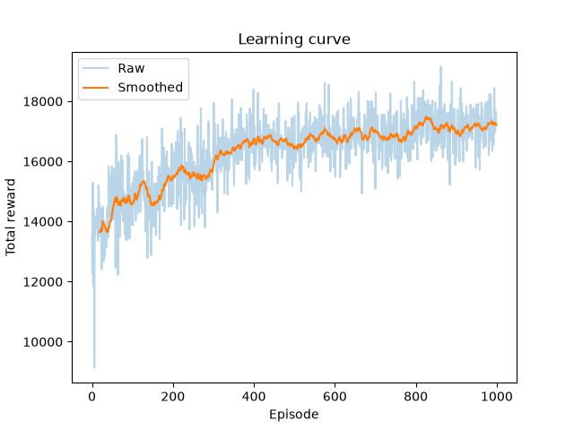
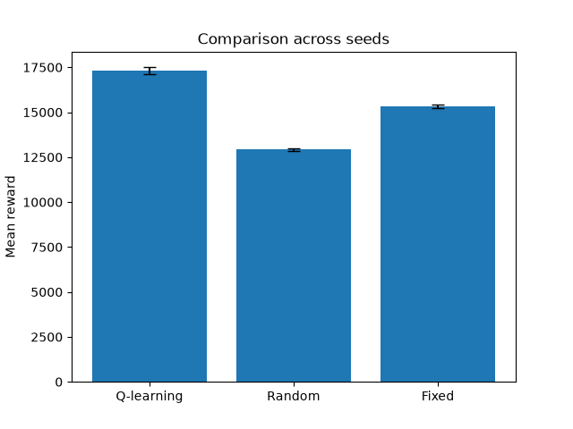
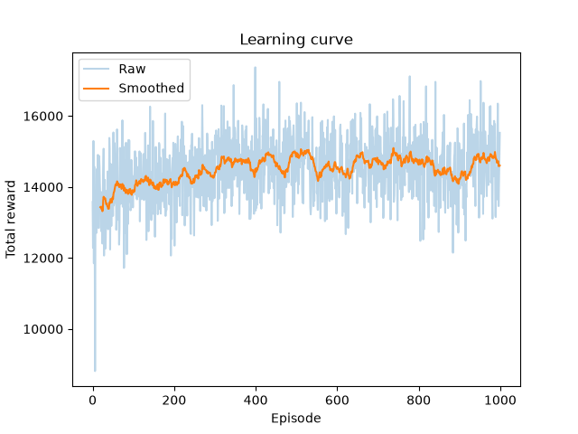
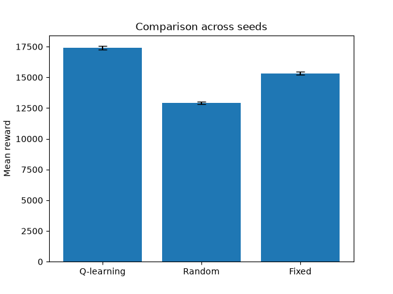

# "Graded project 1": Q-læring for Lagerstyring
Dette prosjektet svarer til en mappeinnlevering, "Graded project 1", i fag-emnet DTE-2602 ved UiT.


## Scenario og motivasjon
I dette prosjektet anvendes Q-læring for lagerstyring. Mer spesifikt så tenkes det at vi har en liten butikk som skal anvende Q-læring for bestilling av melk. Det bestilles melk daglig, men butikken vet aldri hvor mange kunder som ønsker melken. Å bestille for mye melk bringer med seg en kostnad, da det tenkes at kjøling av melken samt kort holdbarhet koster resurser og bør unngås. For lite produkt fører til tapt salg den dagen og bør også unngås. Oppgaven vurderes å være passende for forsterkningslæring da den innebærer sekvensielle avgjørelser og utfall, samt en tilfeldighetsfaktor i form av usikkerheten rundt hvor mye melk som vil selges.


## Modellering
- **Tilstand**: Antall melk på lager (mellom 0 og 30).
- **Handling**: Hvor mye melk som bestilles (mellom 0 og 20).
- **Belønning**: Inntekt minus kostnader for tapt salg, lagring og bestillings-kostnad.
- **Etterspørsel**: Poisson fordeling med gjennomsnitt på 10.
- **Lengde per episode**: 100 dager

Ett "step" skjer i følgende sekvens:
1. Bestilling mottas og legges umiddelbart til lagerstatus.
2. Tilfeldig etterspørsel (Poisson) hentes.
3. Salgsdag gjennomføres
4. Belønnings regnestykket utføres.
5. Lagerstatus etter endt salgsdag returneres.

**Belønnings-formel**:
```bash
reward = sold * ITEM_SALE_PRICE - holding - stockout - order_cost
```

**Parameter-valg**:
- **ALPHA** = 0.05: Veldig lav lærings-rate grunnet tilfeldig etterspørsel (Poisson).
- **GAMMA** = 0.3: Lav fremsikt da produktvalg ble tenkt å være melk, en ferskvare, der fremsikt har mindre betydning.
- **EPSILON** = 0.6: Tanken er at ved aktiv epsilon-decay skal agenten utforske ganske mye i starten, og senere snevre inn utforskningen.

## Resultater
I resultat under var det implementert to "forbedringer", epsilon-decay som var en valgfri forbedring, og separat greedy evaluering som var et krav satt av oppgaveteksten:
1. **epsilon-decay**:
Agenten utforsker mye i starten og peiler seg sakte inn mot beste kjente handling. Dette var tenkt som en god implementasjon da utforskning tidlig gjør at agenten får prøve et større spekter av handlinger før så gradvis å utforske nærmere og nærmere den endelige verdien.
Det viser seg i resultatene under at denne "forbedringen" ikke hadde betydelig påvirkning på prestasjon av agenten for parametrene satt i denne oppgaven.
2. **separat greedy evaluering**:
Agenten utforsker under trening, men når endelig ytelse evalueres settes epsilon til 0. Dette for å tydeliggjøre resultat av treningen. Agenten behøver ikke utforske under evaluering, da det er best å holde seg til det det har lært for å tydeliggjøre om det den har lært til nå faktisk fungerer. Denne "forbedringen" ble implementert da oppgaveteksten ba om det. Det tenkes samtidig at dette er en faktisk forbedring da det absolutt gir mening å bruke ferdiglært politikk under evaluering av læringen, og ikke bare utforske videre, som kunne vært tilfelle uten denne forbedringen.

### Parametre for resultatene under:
- **ALPHA** = 0.05, **GAMMA** = 0.3, **EPSILON_START** = 0.6
- **EPISODES** = 1000, **EVAL_EPISODES** = 100, **NR_OF_SEEDS** = 25
- **MAX_INVENTORY** = 30, **MAX_ORDER** = 20, **DEMAND_MEAN** = 10

(Her er noen av de viktigste parametrene brukt for kjøring av programmet som ga resultatene under. Se parameters.py for alle parametere)

### Med ε-decay
| Metode       | Gjennomsnitt | Std   |
|--------------|--------------|-------|
| Q-learning   | 17314        | 191.3 |
| Fixed        | 15331        | 117.6 |
| Random       | 12917        | 94.5  |



(om leser bruker en .md-leser som ikke visualiserer plots, så finnes disse plottene i prosjektmappen (w_decay)

Q-learning presterer bedre enn random- og fixed-baseline.

### Uten ε-decay
| Metode       | Gjennomsnitt | Std   |
|--------------|--------------|-------|
| Q-learning   | 17402        | 143.1 |
| Fixed        | 15331        | 117.6 |
| Random       | 12917        | 94.5  |



(om leser bruker en .md-leser som ikke visualiserer plots, så finnes disse plottene i prosjektmappen (wo_decay)

Sammenligner vi de to tabellene, med og uten epsilon decay, ser vi at denne implementasjonen (e-decay) ikke gir tydelig bedre resultater ved parametrene som ble testet for.

### Lært politikk (med ε-decay)
| Lager | Beste ordre |          | Lager | Beste ordre |
|-------|-------------|----------|-------|-------------|
| 0     | 10          |          | 16    | 6           |
| 1     | 12          |          | 17    | 13          |
| 2     | 12          |          | 18    | 9           |
| 3     | 9           |          | 19    | 5           |
| 4     | 10          |          | 20    | 2           |
| 5     | 8           |          | 21    | 6           |
| 6     | 9           |          | 22    | 6           |
| 7     | 9           |          | 23    | 4           |
| 8     | 3           |          | 24    | 11          |
| 9     | 4           |          | 25    | 8           |
| 10    | 4           |          | 26    | 0           |
| 11    | 1           |          | 27    | 11          |
| 12    | 7           |          | 28    | 4           |
| 13    | 6           |          | 29    | 0           |
| 14    | 5           |          | 30    | 0           |
| 15    | 2           |          |       |             |

Politikken bestiller mer ved lav verdi for lagerstatus og mindre ved høy lagertatus. Høyt lagernivå nås sjelden når agenten følger lært politikk, og q-verdiene vil være mindre sikker rundt disse veriene.


**Tabellene over** viser de viktigste parametre fra parameters.py, utfallet av læringen samt evaluerings utfallene fra random- og fixed-baseline, som er tilfeldige bestillinger og faste bestillinger av gjennomsnittlig etterspørsel. Plottene fra kjøring av main.py lagres direkte i prosjektmappen og viser stolpediagram av de forskjellige utfallene og læringskurven for q-læringen. Plottene fra de spesifikke gjennomføringene fremvist her finnes i undermappen "Plots". Videre fremvises også "learned policy", som er hva en ferdigtrent agent vil bestille i forhold til lagerstatus.


### Tolkning av resultater
**Q-learning viser bedre resultat** ved de satte parametere enn både tilfeldige- og fastsatte- bestillinger. Dette tyder på at agenten har lært en noe nyttig politikk.

**Politikken ("learned policy") bestiller mer når lageret er tomt**, og mindre jo mer som er på lager. Unntaket er når lagerstatus er betydelig høyere over "DEMAND_MEAN". Lageret når sjeldent veldig høy status, og agenten får ikke nok erfaring rundt disse nivåene til å sette en bedre policy for disse nivåene. Samtidig er det mindre behov for god policy rundt verdier som sjeldent oppnås.

**Læringskurven (fra plottene) er støyete**. Med tilfeldig etterspørsel er dette å forvente, da flere like handlinger ved samme tilstand vil gi forskjellig belønning ut i fra etterspørselen den dagen. Det ble lagt til en "smooth"-graf, som er gjennomsnittlig læring, for bedre representasjon av læringskurven.

I plottet av **læringskurve uten e-decay**, kommer det frem en lavere kurve enn med decay. Allikevel ser vi at den enderlige politikken uten decay faktisk presterer like bra eller litt bedre enn med decay. Ved høy epsilon utforskes det mye gjennom hele treningen og agenten presterer litt lavere da den utforsker hele tiden. Når evaluering kjøres settes epsilon til 0 og agenten bruker bare beste kjente handling og presterer da på sitt beste ved hver gjennomføring, da den ikke utforsker lengre.

**e-decay ga ingen tydelig forbedring** i politikk for oppgaven gitt de satte parametere. Det tenkes at oppgaven "lagerstatus", slik den er satt opp i dette programmet, blir litt for enkel, og at innsnevring av sannsynlighet for utforskning derfor har mindre effekt enn ved ett vanskeligere problem.

### Konklusjon
Resultatene som helhet tyder på at Q-læring fungerer greit for denne typen oppgave, da politikken presterer bedre enn både random- og fixed-baseline. e-decay antas å være mer passende for mer komplekse oppgaver, men videre eksperimentering behøves før dette kan påstås med bedre sikkerhet.


## Begrensninger
Dette prosjektet, som det står nå, ansees å være et greit utgangspunkt for løsning av "lagerstatus-problemet". Programmet svarer til oppgaven slik den er formulert. Under utvikling fremkom det flere begrensninger med programmet om skulle det anvendes i et virkelig scenario. Noen av disse begrensningene er:
- Bestillingene kommer momentant. Det er ingen leveringstid.
- Etterspørsel er tilfeldig rundt et gjennomsnitt. Etterspørselen av melk er det samme gjennom uka osv.
- Veldig snevert område for tilstand og handling.
- Kanskje bedre å sette "fixed-baseline" til litt under "DEMAND_MEAN".
Disse, med flere, "snarveier" med programmet gjør oppgaven mindre realistisk.


## Hvordan kjøre programmet
**Fra prosjektmappen**:

**Lag virituelt miljø**:
```bash
python -m venv venv
source venv/bin/activate
pip install -r requirements.txt
```
**Kjør program**:
```bash
python main.py
```
Nye plots lagres i prosjektmappen etter kjøring.

**Brukerinnstillinger** finnes i parameters.py

### Om resultater "uten e-decay" ønskes å igenskapes må epsilon deaktiveres i parameters.py:
```bash
EPSILON_DECAY_ENABLE = False
```
